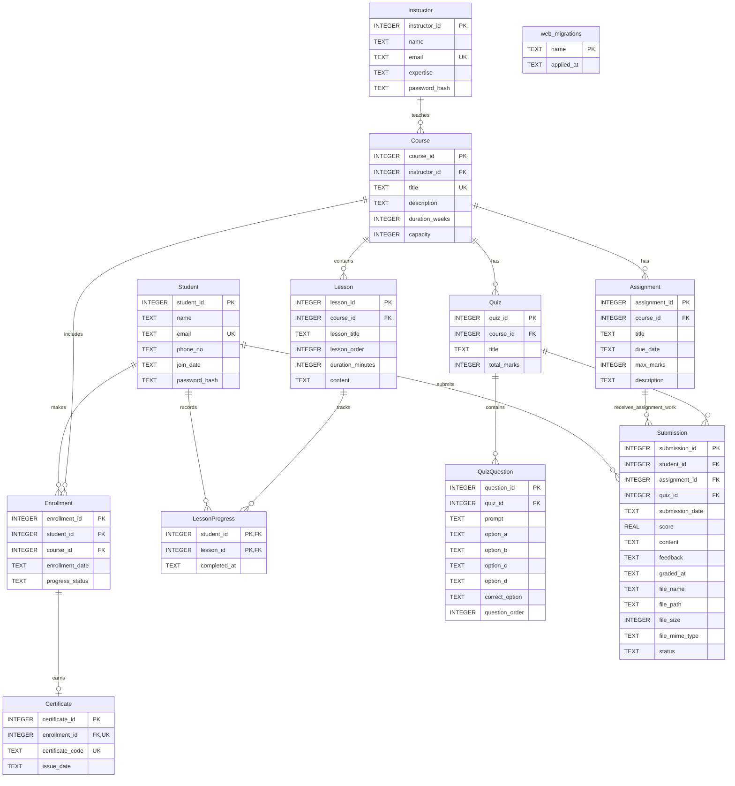

# LearnHub ER Diagram

This diagram follows the current SQLite tables used by the LearnHub browser application. `phone_no` is optional for students. A submission is linked to exactly one assignment or one quiz, as enforced by the database check constraint.

`Enrollment` also enforces one row per student and course. `LessonProgress` uses the student and lesson identifiers together as its primary key, so a student's completion for a lesson is recorded once. `Submission` permits only one of `assignment_id` or `quiz_id` for each row. The database also limits a student to one assignment submission per assignment. `web_migrations` is the backend's startup migration-tracking table; it is not connected to the learning records.
